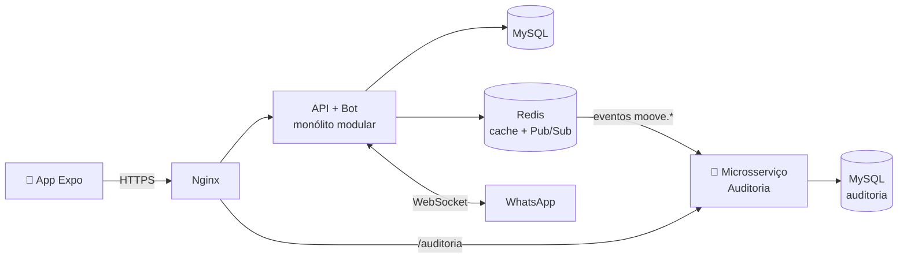

# 🚐 Moove – Gestão de transporte de funcionários com bot de WhatsApp

O Moove automatiza a operação de transporte de funcionários de empresas clientes:

- **motoristas** entram na fila do dia reagindo com 👍 no grupo de WhatsApp;
- o sistema gera a **escala** (plantão, rotas da tarde e da madrugada, apoio e backup) e atribui as **rotas** com os passageiros;
- o **administrador** acompanha e ajusta tudo por um **app mobile**.

| | |
|---|---|
| **Back-end** (`whatsappBot/`) | Node.js · Express 5 · TypeScript · TypeORM · MySQL 8 · Redis 7 · Baileys · node-cron · pino |
| **App** (`jcha_app/`) | React Native · Expo · TypeScript · Axios |
| **Microsserviço** (`auditoria/`) | Node.js · Express 5 · TypeScript · mysql2 · ioredis: histórico de eventos com banco próprio |
| **Infra** | Docker Compose · Nginx (proxy reverso/TLS) · GitHub Actions |

## Arquitetura em 30 segundos



📚 **Documentação completa:** [`docs/`](docs/README.md). Inclui C4, ADRs, DDD, OpenAPI, SLOs, resiliência, observabilidade, CI/CD, runbook, Cynefin, PM Canvas, backlog e Jira.

## Como rodar

### Com Docker (recomendado)
```bash
git clone --recurse-submodules https://github.com/123JChaves/app-moove.git
cd app-moove
cp .env.example .env            # preencha as variáveis
npm install                     # husky (hooks de commit/push)
npm run docker:tudo             # db + redis + backend + db-auditoria + auditoria + nginx
npm run docker:health           # {"status":"UP", ...}
npm run docker:frontend            # (opcional) app Expo na porta 8081
```
Na primeira execução, leia o QR Code do WhatsApp em `npm run docker:logs`.

### Local (sem Docker)
```bash
npm run local:install
# MySQL e Redis locais rodando (ou REDIS_ENABLED=false para rodar sem cache)
npm run local:backend
npm run local:frontend
```

## Como rodar: dois modos

> ⚠️ **Nunca rode os dois modos ao mesmo tempo.** A sessão do WhatsApp aceita uma única conexão, e os dois back-ends usam a mesma sessão.
> Os **dados são diferentes** em cada modo. No Docker, o banco fica no volume `db_data` (DBeaver em `127.0.0.1:3307`). No modo local, o banco é o do XAMPP (`127.0.0.1:3306`).

### Modo 1 – COM containers (Docker)
Pré-requisito: Docker Desktop aberto.

Entrada da aplicação: **`http://127.0.0.1:8080`** (Nginx). A porta 8080 é usada porque o Apache do XAMPP ocupa a 80 no Windows. Ela é configurada em `NGINX_HTTP_PORT` no `.env`.

| Ordem | Comando (um CMD para cada) | O que faz |
|---|---|---|
| — | `npm run docker:iniciar` | Faz tudo abaixo sozinho, abrindo uma janela por serviço |
| 1 | `npm run docker:infra` | MySQL, Redis e MySQL da auditoria, em segundo plano |
| 2 | `npm run docker:backend` | API + WhatsApp |
| 3 | `npm run docker:auditoria` | Microsserviço de auditoria |
| 4 | `npm run docker:nginx` | Proxy na porta 80, em segundo plano |
| 5 | `npm run docker:ngrok` | Túnel para o app Android (aponta para a porta 80) |
| 6 | `npm run docker:frontend` | App Expo |

Outros: `docker:parar`, `docker:status`, `docker:diagnostico`, `docker:health`, `docker:logs:backend`, `docker:rebuild` (após mudar código ou dependências).

### Modo 2 – SEM containers (direto no Windows)
Pré-requisitos: MySQL do XAMPP ligado na 3306 e `npm run local:install` feito uma vez.

| Ordem | Comando (um CMD para cada) | O que faz |
|---|---|---|
| — | `npm run local:iniciar` | Faz tudo abaixo sozinho (e para os containers da aplicação antes) |
| 1 | `npm run local:backend` | API + WhatsApp na porta 8085 (usa `whatsappBot/.env`) |
| 2 | `npm run local:auditoria` | Microsserviço na porta 8090 (usa `auditoria/.env`; cria o banco `moove_auditoria` sozinho) |
| 3 | `npm run local:frontend` | App Expo (usa `jcha_app/.env`) |
| 4 | `npm run local:ngrok` | Túnel para o app Android (aponta para a porta 8085) |

Sem Redis no Windows, o cache e os eventos ficam desligados (`REDIS_ENABLED=false` nos `.env`), e a aplicação funciona normalmente. Para ligá-los, rode `npm run local:redis` (sobe **só** o Redis em container) e troque para `REDIS_ENABLED=true` em `whatsappBot/.env` e `auditoria/.env`.

Teste: `npm run local:health` e `npm run local:health:auditoria`.

## Scripts úteis

| Script | O que faz |
|---|---|
| `npm run docker:logs` | Logs de backend, db, redis e nginx |
| `npm run docker:redis:monitor` | Mostra os comandos chegando ao Redis (demo do cache) |
| `npm run docker:redis:eventos` | Escuta os eventos `moove.*` (demo do Pub/Sub) |
| `npm run docker:redis:chaves` | Lista as chaves de cache |
| `npm run test:backend` / `npm run test:auditoria` | Testes unitários (Jest) do monólito / do microsserviço |
| `npm run docker:health:auditoria` | Readiness do microsserviço |
| `npm run local:test:login` / `local:test:cadastro` / `local:test:jornada` | Testes E2E |
| `./scripts/deploy.sh <sha> [backend\|auditoria]` / `./scripts/rollback.sh <sha> [servico]` | Deploy independente por serviço, com rollback automático |

## Endpoints de operação

| Endpoint | Uso |
|---|---|
| `GET /health` | Liveness |
| `GET /health/ready` | Readiness (MySQL, Redis, WhatsApp) |
| `GET /metrics` | Métricas Prometheus (rede interna) |
| `GET /auditoria/health/ready` · `GET /auditoria/eventos` | Microsserviço de auditoria ([README](auditoria/README.md)) |

## Contribuição

- Branches `feature/SCRUM-<id>-descricao` → PR para `develop`.
- Commits no padrão **Conventional Commits** (validado pelo Husky): `feat: ...`, `fix: ...`, `docs: ...`.
- Toda decisão arquitetural relevante vira uma **ADR** em `docs/adr/`.
- Mudanças por versão: [CHANGELOG.md](CHANGELOG.md).
