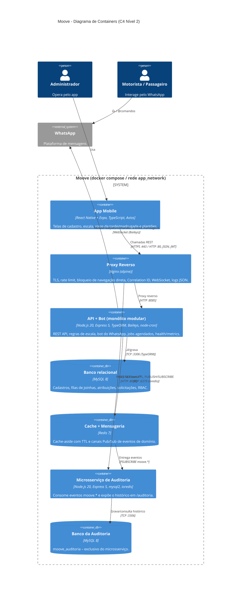
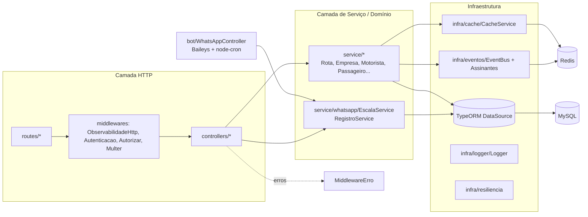

# C4 – Nível 2: Diagrama de Containers

> **Pergunta respondida:** *quais são as unidades executáveis/implantáveis do Moove e como elas se comunicam?*
> Cada container abaixo corresponde a um serviço do [`docker-compose.yml`](../../docker-compose.yml).

## Containers

| Container | Tecnologia | Responsabilidade | Porta / exposição |
|---|---|---|---|
| **frontend** (`jcha_app`) | Expo 57, React Native, TypeScript | Interface do administrador | `8081` (Metro), perfil `front` |
| **nginx** | `nginx:alpine` | Única porta de entrada; TLS (`nginx/certs`), rate limit 20 req/s por IP, bloqueio de acesso direto pelo navegador, propagação de `X-Request-Id`, `/health` público, `/metrics` só na rede interna | `${NGINX_HTTP_PORT}:80`, `${NGINX_HTTPS_PORT}:443` |
| **backend** (`whatsappBot`) | Node 20, Express 5, TypeORM 0.3, Baileys 7, pino, ioredis | REST API, bot do WhatsApp, cron (geração de escala às 20:25, banimentos às 20:05, rotas da madrugada às 16:00), RBAC/JWT | `8085` apenas na rede interna (`expose`) |
| **db** | MySQL 8.0 | Persistência transacional | `3306` apenas interno, volume `db_data` |
| **redis** | Redis 7 alpine | Cache distribuído (LRU, 128 MB, sem persistência) + barramento Pub/Sub | `6379` apenas interno |
| **auditoria** (`auditoria/`) – **microsserviço** | Node 20, Express 5, mysql2, ioredis, pino | Consome `moove.*`, grava o histórico de forma idempotente, API `/auditoria/*` com JWT, DLQ, retenção de 180 dias | `8090` apenas interno |
| **db-auditoria** | MySQL 8.0 | Banco **exclusivo** do microsserviço (`moove_auditoria`) | `3306` apenas interno, volume `db_auditoria_data` |

## Componentes internos da API (visão resumida – C4 Nível 3)

## Decisões relacionadas

- [ADR 0001 – Monólito modular em vez de microsserviços](../adr/0001-monolito-modular.md)
- [ADR 0002 – MySQL com TypeORM](../adr/0002-mysql-com-typeorm.md)
- [ADR 0003 – Redis com cache-aside](../adr/0003-redis-cache-aside.md)
- [ADR 0004 – Redis Pub/Sub para eventos de domínio](../adr/0004-redis-pubsub-eventos.md)
- [ADR 0005 – Nginx como proxy reverso](../adr/0005-nginx-proxy-reverso.md)
- [ADR 0008 – Microsserviço de Auditoria](../adr/0008-microsservico-de-auditoria.md)
