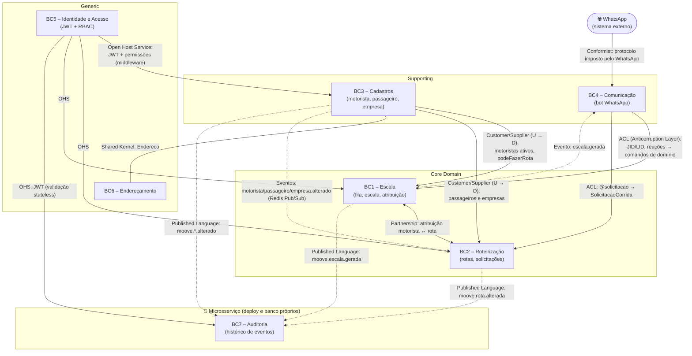

# DDD – Subdomínios, Bounded Contexts e Context Map

## 1. Linguagem ubíqua (glossário)

| Termo | Significado no negócio | No código |
|---|---|---|
| **Joinha** | Reação 👍 do motorista na mensagem do dia no grupo; é o que o coloca na fila | `OrdemJoinha` |
| **Lista de joinhas / Lista mãe** | Fila de motoristas de um dia (dia X), na ordem das reações | `ListaJoia` |
| **Posição efetiva** | Posição final na fila, depois de penalidades e ajustes manuais | `OrdemJoinha.posicaoEfetiva` |
| **Penalizado** | Motorista com punição; vai para o fim da fila | `isPenalizado`, `Banimento` |
| **Escala** | Distribuição da fila em categorias: Plantão, Rota, Apoio, Backup, Livre | `EscalaService.gerarEscalaCompleta` |
| **Plantão** | Primeiras posições da fila, ficam à disposição (sem rota fixa) | `limitePlantao` |
| **Rota da tarde (IDA)** | Leva passageiros ao trabalho; executada no dia X+1 | `tipo_rota = ROTA_TARDE` |
| **Rota da madrugada (VOLTA)** | Traz passageiros de volta; executada no dia X+2 | `tipo_rota = ROTA_MADRUGADA` |
| **Apoio** | Motorista reserva para a última rota da tarde | `tipoAtribuicao = APOIO`, `isApoioManual` |
| **Dia livre / Dia comum** | Feriado/folga, com regra de escala reduzida, ou dia normal | `DiasTipo` |
| **Atribuição** | Vínculo motorista ↔ rota ↔ data de execução | `RotaAtribuida` (`atribuicao_final`) |
| **Solicitação de corrida** | Pedido do passageiro para ida ou volta numa data | `SolicitacaoCorrida` |
| **LID** | Identificador anônimo do usuário no WhatsApp | `whatsAppLid` |

## 2. Subdomínios

| Subdomínio | Tipo | Por quê |
|---|---|---|
| **Escala e Fila de Motoristas** | 🟥 **Core** | É o diferencial do Moove: transforma reações em uma escala justa e automática |
| **Roteirização e Transporte** | 🟥 **Core** | Montagem de rotas, ordem de embarque, vínculo com solicitações |
| **Cadastro de Parceiros** (motoristas, passageiros, empresas) | 🟨 Suporte | Necessário, mas sem diferencial competitivo |
| **Comunicação via WhatsApp** | 🟨 Suporte | Canal operacional; integração específica do negócio |
| **Identidade e Acesso** (usuários, papéis, permissões) | ⬜ Genérico | Problema resolvido (JWT + RBAC) |
| **Endereçamento** (país, estado, cidade, bairro, endereço) | ⬜ Genérico | Poderia vir de um serviço externo (ex.: ViaCEP) |
| **Auditoria** (histórico de fatos de domínio) | 🟨 Suporte | Necessário para a operação (contestação de escala) e para a LGPD; sem diferencial competitivo |

## 3. Bounded Contexts

| Bounded Context | Responsabilidade | Modelos (entidades) | Código principal |
|---|---|---|---|
| **BC1 – Escala** | Fila do dia, penalidades, dias livres, geração da escala e atribuições | `ListaJoia`, `OrdemJoinha`, `DiasTipo`, `Banimento`, `RotaAtribuida` | `service/whatsapp/EscalaService.ts`, `RegistroService.ts`, `routes/RotasWhatsApp.ts`, `RotasAtribuicao.ts` |
| **BC2 – Roteirização** | Rotas, turnos, ordem de embarque, solicitações | `Rota`, `ListaRota`, `SolicitacaoCorrida` (+ visão de `Passageiro` embarcado) | `service/RotaService.ts`, `routes/RotasRota.ts` |
| **BC3 – Cadastros** | Ciclo de vida de motoristas, passageiros e empresas | `Motorista`, `Passageiro`, `Empresa` | `MotoristaService`, `PassageiroService`, `EmpresaService` |
| **BC4 – Comunicação** | Traduz o WhatsApp para comandos do domínio e publica mensagens | — (sem entidades próprias; usa sessão Baileys) | `bot/WhatsAppController.ts`, `utils/formatters/whatsappFormatters.ts` |
| **BC5 – Identidade e Acesso** | Login, JWT, papéis e permissões | `Usuario`, `Papeis`, `Permissoes`, `Administrador` | `AutenticacaoService`, `RbacService`, `middlewares/Autenticacao`, `Autorizar` |
| **BC6 – Endereçamento** | Hierarquia geográfica | `Pais`, `Estado`, `Cidade`, `Bairro`, `Endereco` | `BairroService`, `CidadeService`... + `BuscarOuCriar` |
| **BC7 – Auditoria** 🧩 *microsserviço* | Registrar e consultar os eventos de domínio | `EventoAuditoria` (aggregate root, id = id do evento) | **`auditoria/`** (deploy e banco próprios) |

> **Atenção à mesma palavra em contextos diferentes:** em **Cadastros**, *Motorista* tem nome, telefone, LID e status. Em **Escala**, *Motorista* é só "quem está na posição N da fila", se pode fazer rota e se está penalizado. Em **Roteirização**, *Passageiro* é "quem embarca na rota, em qual ordem".

## 4. Context Map

### Padrões de relacionamento usados

| Relação | Padrão | Justificativa |
|---|---|---|
| WhatsApp → Comunicação | **Conformist** | Não temos poder sobre o protocolo e nos adaptamos a ele |
| Comunicação → Escala / Roteirização | **Anticorruption Layer** | O `WhatsAppController` impede que conceitos do WhatsApp (JID, `@lid`, `reactionMessage`) vazem para o domínio |
| Escala ↔ Roteirização | **Partnership** | Evoluem juntos: a escala define quem dirige e a roteirização define o quê/onde |
| Cadastros → Escala / Roteirização | **Customer/Supplier** | Cadastros (upstream) fornece motoristas e passageiros; os consumidores dependem desse contrato |
| Cadastros ↔ Endereçamento | **Shared Kernel** | `Endereco` é compartilhado e alterações exigem acordo |
| Identidade → todos | **Open Host Service** | Protocolo publicado (JWT + `PermissoesDoSistema`) consumido via middleware |
| Cadastros → Roteirização (eventos) | **Published Language** | Envelope de evento padronizado (`EnvelopeEvento`) nos canais `moove.*` |
| Monólito (Escala, Roteirização, Cadastros) → **Auditoria** | **Published Language + Conformist** | O microsserviço só consome o envelope publicado e valida o contrato. O monólito não sabe que ele existe (acoplamento mínimo) |
| Identidade → Auditoria | **Open Host Service** | O JWT do `POST /login` é validado sem consultar o banco do monólito |

➡️ Detalhamento tático: [modelo-de-dominio.md](modelo-de-dominio.md)
