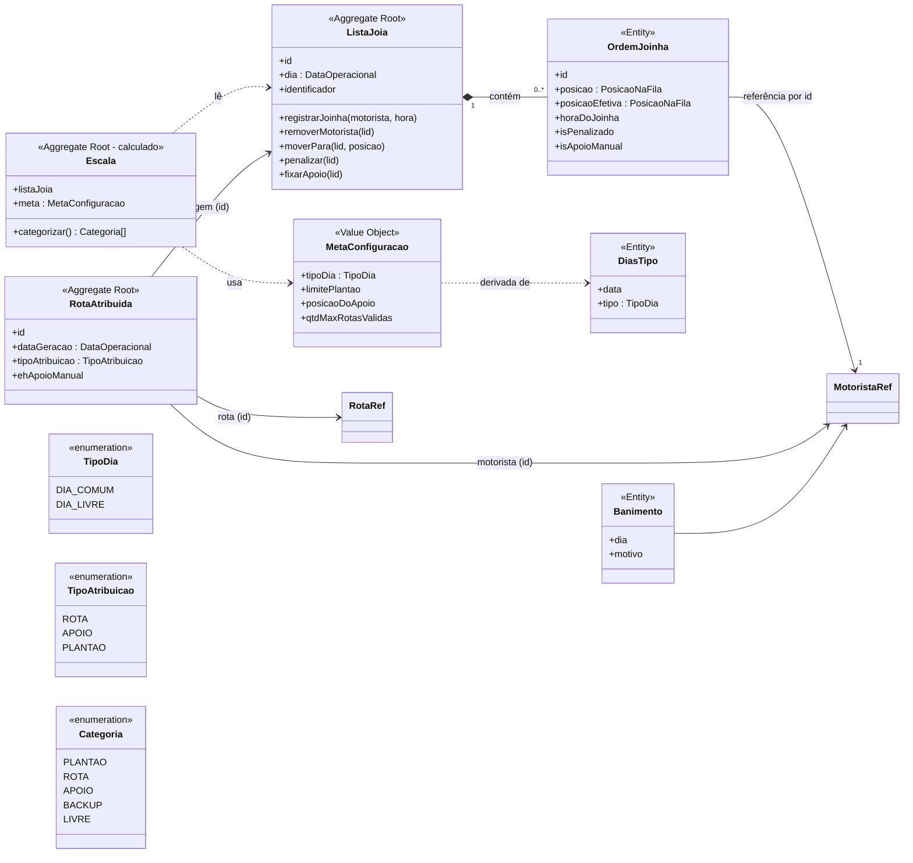

# DDD Tático – Entities, Value Objects e Aggregates

> Foco no **BC1 – Escala** (core). Os demais contextos aparecem resumidos no fim do documento.

## 1. BC1 – Escala

### Aggregates e invariantes

| Aggregate (raiz) | Contém | Invariantes que a raiz protege |
|---|---|---|
| **ListaJoia** (Fila do dia) | `OrdemJoinha[]` (cascade) | 1. Só existe **uma lista por dia** (`dia` único). 2. Um motorista aparece **no máximo uma vez** na lista. 3. Motoristas **penalizados** ficam depois dos não penalizados (ordem: `isPenalizado ASC, posicaoEfetiva ASC, horaDoJoinha ASC`). 4. Motorista com `isApoioManual` **não muda de posição** no recálculo automático. 5. Motorista **inativo** ou **banido** no dia não entra na fila. |
| **RotaAtribuida** (Atribuição) | — | 1. Uma rota tem **no máximo um motorista** por `dataGeracao`. 2. Motorista com `podeFazerRota = false` (só plantão) **não** recebe rota. 3. Rota da tarde → execução em X+1; madrugada → X+2; última rota da tarde = **APOIO**. 4. Atribuição manual (`ehApoioManual`) não é sobrescrita pela geração automática. |
| **Escala** (calculada, não persistida) | — | Categorias derivadas da posição + `MetaConfiguracao`: em DIA_COMUM, posições 1..`limitePlantao` = PLANTÃO, `posicaoDoApoio` = APOIO e até `qtdMaxRotasValidas` = ROTA; em DIA_LIVRE, plantão reduzido e o resto LIVRE. |

> **Regra de referência entre aggregates:** aggregates se referenciam **por id** (`motoristaId`, `listaJoiaId`), nunca por objeto carregado e alterado em conjunto. Por isso, alterar um Motorista no BC3 não altera a fila do BC1 na mesma transação.

### Value Objects

| Value Object | Regras / validação | Onde aparece |
|---|---|---|
| **TelefoneWhatsApp** | Só dígitos (`replace(/\D/g,'')`), com DDI | Motorista, Passageiro, Usuario |
| **WhatsAppLid** | Remove o sufixo de dispositivo (`:[0-9]+`) e o domínio `@lid` | `MotoristaService.resolverMotorista` |
| **CPF** | Dígitos verificadores | `validators/ValidacaoDeCpf.ts` |
| **CNPJ** | Dígitos verificadores | `validators/ValidacaoDeCnpj.ts` |
| **Email** | Formato | `validators/ValidacaoDeEmail.ts` |
| **NomePessoa** | Sanitizado (capitalização, espaços) | `TextoHelper.sanitizarNome` |
| **DataOperacional** | Data pura `AAAA-MM-DD`, sem fuso (evita bugs de virada de dia) | `formatarDataIsoPura`, `SolicitacaoCorrida.dataViagem` |
| **PosicaoNaFila** | Inteiro ≥ 1 | `OrdemJoinha` |
| **TipoDia**, **TurnoRota** (`ROTA_TARDE`/`ROTA_MADRUGADA`), **TipoTurno** (`IDA`/`VOLTA`), **TipoAtribuicao**, **Categoria** | Enumerações fechadas | Modelos e payloads |
| **MetaConfiguracao** | Imutável, calculada a partir de `DiasTipo` + data | `CalcularMetaConfiguracao.ts` |
| **Horario** | `HHhMM` (ex.: `18h00`) | `Rota.horario` |

Os value objects acima ainda aparecem como tipos primitivos nas entidades TypeORM (validados nos services/helpers). A evolução recomendada é encapsulá-los em classes imutáveis (ex.: `new Cpf(valor)` lança erro se for inválido). Isso está no backlog como **SCRUM-45**.

## 2. Demais contextos (resumo)

### BC2 – Roteirização
| Elemento | Tipo | Observação |
|---|---|---|
| **Rota** | **Aggregate Root** | Contém a ordem dos passageiros (`ordem_na_rota`) e as empresas atendidas. Invariante: ordens sequenciais 1..N sem repetição (`vincularPassageirosARota`) |
| ListaRota | Entity | Agrupa rotas por turno |
| **SolicitacaoCorrida** | **Aggregate Root** | Única por (passageiro, dataViagem, tipoTurno) |
| TurnoRota, Horario | Value Objects | — |

### BC3 – Cadastros
| Elemento | Tipo | Invariantes |
|---|---|---|
| **Motorista** | Aggregate Root | `whatsAppLid` único; nome sanitizado; `ativo` controla a entrada na fila |
| **Passageiro** | Aggregate Root | Telefone e LID únicos; obrigatoriamente com endereço e empresa |
| **Empresa** | Aggregate Root | CNPJ válido e único |
| Endereco | Entity (Shared Kernel com BC6) | Candidato a Value Object |

### BC5 – Identidade e Acesso
| Elemento | Tipo | Observação |
|---|---|---|
| **Usuario** | Aggregate Root | Senha com bcrypt; e-mail e CPF únicos |
| Papeis, Permissoes | Entities | Semeados por `rodarSeedRbac()` a partir do `DicionarioRbac` |

## 3. Eventos de domínio

| Evento | Quando | Publicado em |
|---|---|---|
| `moove.rota.alterada` | Rota criada, editada ou excluída | `RotaService.aposAlteracao` |
| `moove.empresa.alterada` | Empresa criada, editada ou excluída | `EmpresaService.aposAlteracao` |
| `moove.motorista.alterado` | Cadastro, edição, ativação/inativação, vínculo de LID ou exclusão | `MotoristaService.aposAlteracao` |
| `moove.passageiro.alterado` | Cadastro, edição, ativação/inativação ou exclusão | `PassageiroService.aposAlteracao` |
| `moove.escala.gerada` | Escala gerada ou refeita pelo app | `routes/RotasWhatsApp.ts` |

Detalhes: [mensageria-pubsub.md](../06-backend-avancado/mensageria-pubsub.md)
