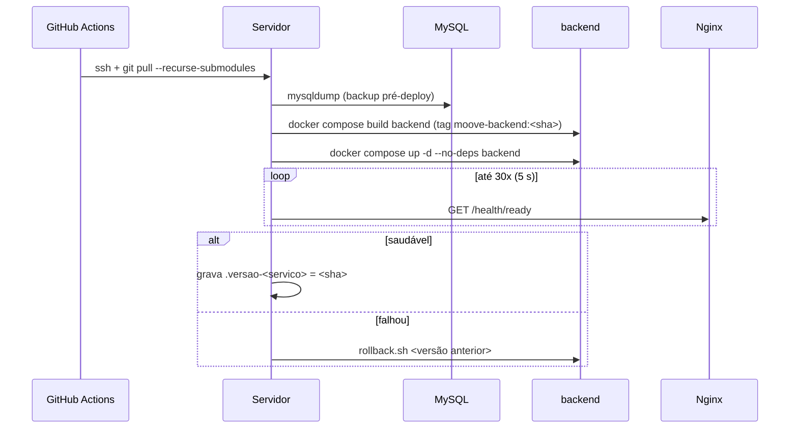

# Estratégia de Deploy

**Estratégia escolhida:** *Recreate* (substituição simples do container do back-end) **com rollback automático** baseado em health check.
Justificativa completa: [ADR 0006](../adr/0006-estrategia-de-deploy.md). Em resumo, a sessão do WhatsApp aceita uma única conexão, o que inviabiliza Blue/Green e Canary.

## Deploy independente por serviço

| Serviço | Comando | Estratégia | Observação |
|---|---|---|---|
| Monólito (`backend`) | `./scripts/deploy.sh <sha> backend` | Recreate + rollback | Instância única (sessão do WhatsApp) |
| Microsserviço (`auditoria`) | `./scripts/deploy.sh <sha> auditoria` | Recreate + rollback | Pode ser implantado **a qualquer hora**: não afeta escala nem bot. Como é idempotente, pode evoluir para rolling com 2 réplicas |

Cada serviço tem imagem versionada (`moove-backend:<sha>`, `moove-auditoria:<sha>`), backup do **próprio** banco e arquivo de versão próprio (`.versao-backend`, `.versao-auditoria`).

## Passo a passo (`scripts/deploy.sh <versao> [servico]`)

| Item | Definição |
|---|---|
| Janela de deploy | **Fora de 19:30–20:45** (formação da fila e geração da escala às 20:25) e fora de 15:45–16:15 (rotas da madrugada às 16:00). Preferência: 09:00–15:00 |
| Downtime esperado | 30–60 s (reconexão do WhatsApp incluída) |
| Critério de sucesso | `GET /health/ready` → 200 com `mysql: UP` |
| Rollback automático | Se o critério não for atendido em 150 s |
| Rollback manual | `./scripts/rollback.sh <sha>` (ver [runbook §7](runbook-incidentes.md)) |
| Banco de dados | Backup antes de cada deploy em `backups/`. Migrations seguem *expand → migrate → contract*: nunca remover coluna na mesma versão que deixa de usá-la |
| Comunicação | Aviso no grupo de administradores antes e depois do deploy |

## Checklist pré-deploy
- [ ] Pipeline verde na `main`
- [ ] CHANGELOG atualizado e tag SemVer criada
- [ ] Migrations revisadas (são reversíveis?)
- [ ] Fora da janela crítica
- [ ] Error budget > 0 ([política](../04-qualidade/slos-slis.md#política-de-error-budget))
