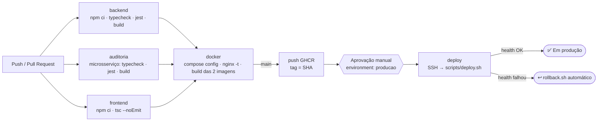

# Pipeline CI/CD

Arquivo: [`.github/workflows/ci-cd.yml`](../../.github/workflows/ci-cd.yml) (GitHub Actions)



## Etapas

| Job | Gatilho | O que faz | Falha bloqueia? |
|---|---|---|---|
| **backend** | todo push/PR em `main`/`develop` | Instala dependências, `tsc --noEmit`, testes Jest (cache-aside, Pub/Sub, resiliência), `tsc` build e upload do `dist` | Sim |
| **auditoria** | idem | Pipeline **independente** do microsserviço: typecheck, 14 testes (service, consumidor Pub/Sub, API com supertest), build | Sim |
| **frontend** | idem | Typecheck do app Expo | Sim |
| **docker** | após backend + frontend | Valida o `docker-compose.yml`, valida o `nginx.conf` com `nginx -t`, builda a imagem do back-end; na `main`, publica no GHCR com tag = SHA | Sim |
| **deploy** | só push na `main` | Exige **aprovação manual** (GitHub Environment `producao`), conecta via SSH e executa `scripts/deploy.sh <sha> auditoria` e depois `scripts/deploy.sh <sha> backend` (um deploy por serviço) | — |

## Proteções complementares (local)
- **Husky `commit-msg`**: valida Conventional Commits (`validar-commit.js`).
- **Husky `pre-push`**: roda os testes E2E de login e cadastro (`executar-testes.js`).

## Secrets necessários (Settings → Secrets and variables → Actions)

| Secret | Uso |
|---|---|
| `SUBMODULES_TOKEN` | PAT com leitura dos repositórios `whatsappBot` e `jcha_app` (são submódulos) |
| `DEPLOY_HOST`, `DEPLOY_USER`, `DEPLOY_SSH_KEY` | Acesso SSH ao servidor. Sem eles, o job de deploy só emite um aviso |

## Fluxo de branches
- `feature/SCRUM-134-descricao` → PR para `develop` (CI completo) → PR `develop` → `main` (release) → deploy aprovado.
- A tag de versão segue **SemVer** e é registrada no [CHANGELOG](../../CHANGELOG.md).

## Como rodar o mesmo que o CI, localmente
```bash
cd whatsappBot && npm install && npm run typecheck && npm run test:ci && npm run build
cd ../auditoria && npm install && npm run typecheck && npm test && npm run build
cd ../jcha_app && npx tsc --noEmit
cd .. && docker compose config --quiet
```
