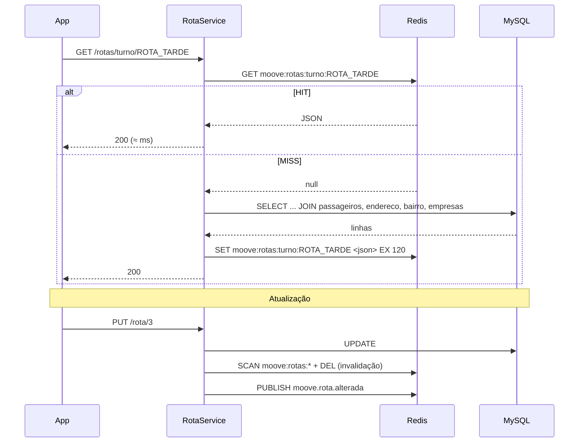

# Cache distribuído com Redis (cache-aside)

> Decisão: [ADR 0003](../adr/0003-redis-cache-aside.md) · Código: `whatsappBot/src/infra/cache/CacheService.ts` · Testes: `src/__tests__/CacheService.test.ts`

## Como funciona



## Onde é aplicado

| Consulta | Chave | TTL | Invalidação |
|---|---|---|---|
| `RotaService.listarRotas` | `moove:rotas:todas` | `CACHE_TTL_ROTAS` = 120 s | `RotaService.aposAlteracao` (criar/editar/excluir), `PassageiroService`, `EmpresaService` |
| `RotaService.listarPorTurno` | `moove:rotas:turno:{ROTA_TARDE\|ROTA_MADRUGADA}` | 120 s | idem |
| `RotaService.mostrarUmaRota` | `moove:rotas:id:{id}` | 120 s | idem |
| `EmpresaService.listarEmpresas` / `mostrarUmaEmpresa` | `moove:empresas:todas` / `moove:empresas:id:{id}` | `CACHE_TTL_EMPRESAS` = 600 s | `EmpresaService.aposAlteracao` |
| `MotoristaService.listarMotoristas` | `moove:motoristas:todos` | `CACHE_TTL_MOTORISTAS` = 60 s | `MotoristaService.aposAlteracao` (inclui ativar/inativar e vínculo de LID) |

### Uso no código (exemplo real)
```ts
static async listarPorTurno(tipo: 'ROTA_TARDE' | 'ROTA_MADRUGADA'): Promise<Rota[]> {
    return cache.obterOuCarregar(ChavesCache.rotasPorTurno(tipo), TTL.ROTAS,
        () => this.listarPorTurnoDoBanco(tipo));
}

private static async aposAlteracao(rotaId: number, acao: 'CRIADA' | 'EDITADA' | 'EXCLUIDA') {
    await cache.invalidarPorPrefixo(ChavesCache.PREFIXO_ROTAS);          // invalidação local
    await eventBus.publicar(CanaisEventos.ROTA_ALTERADA, { rotaId, acao }); // avisa outras instâncias
}
```

## Decisões de projeto
- **TTL** em todas as chaves: limita dados desatualizados se alguém alterar o banco por fora dos services (ex.: o bot).
- **Invalidação por prefixo com `SCAN`**: invalidar a família inteira (`rotas:*`) é mais seguro que calcular quais chaves dependem de um passageiro.
- **Namespace `moove:`**: isola as chaves se o Redis for compartilhado.
- **Não cacheado:** fila de joinhas e escala, porque mudam a cada reação e precisam de consistência imediata.
- **Falha do Redis = bypass**: timeouts de 300 ms; a resposta vem do MySQL.
- Configuração do servidor Redis: `maxmemory 128mb` + `allkeys-lru` + sem persistência (é cache, não fonte de verdade).

## Demonstração (roteiro para apresentação)

```bash
docker compose up -d --build            # sobe db, redis, backend, nginx
TOKEN=$(curl -s -X POST http://localhost:8080/login -H 'Content-Type: application/json' \
  -d '{"email":"admin@moove.com","senha":"<senha>"}' | jq -r .token)

# Terminal 2: ver os comandos chegando ao Redis
npm run docker:redis:monitor

# 1) Primeira chamada -> MISS (log "Cache MISS: consultando o banco") + SET ... EX 120
curl -s -H "Authorization: Bearer $TOKEN" http://localhost:8080/rotas/turno/ROTA_TARDE > /dev/null
# 2) Segunda chamada -> HIT (log "Cache HIT"), sem consulta SQL no log do TypeORM
curl -s -H "Authorization: Bearer $TOKEN" http://localhost:8080/rotas/turno/ROTA_TARDE > /dev/null

# 3) TTL
docker compose exec redis redis-cli TTL moove:rotas:turno:ROTA_TARDE     # ~120 e decrescendo

# 4) Invalidação em update
curl -s -X PUT -H "Authorization: Bearer $TOKEN" -H 'Content-Type: application/json' \
  -d '{"horario":"18h15"}' http://localhost:8080/rota/1
npm run docker:redis:chaves           # as chaves moove:rotas:* sumiram

# 5) Métricas
curl -s http://localhost:8080/metrics | grep moove_cache
```
