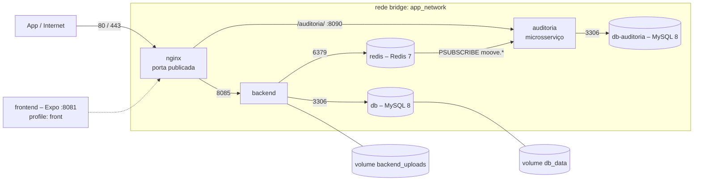

# Orquestração com Docker Compose e Nginx como proxy reverso

> Arquivos: [`docker-compose.yml`](../../docker-compose.yml), [`nginx/nginx.conf`](../../nginx/nginx.conf), `whatsappBot/Dockerfile.backend`, `jcha_app/Dockerfile.frontend`

## Topologia



## Serviços

| Serviço | Imagem | Exposição | Healthcheck | Dependências |
|---|---|---|---|---|
| `db` | `mysql:8.0` | `expose 3306` (interna) | `mysqladmin ping` | — |
| `redis` | `redis:7-alpine` (128 MB, LRU, sem persistência) | `expose 6379` (interna) | `redis-cli ping` | — |
| `backend` | build `Dockerfile.backend` (Node 20) | `expose 8085` (interna) | `wget /health` (start_period 90 s) | `db` **healthy**, `redis` **healthy** |
| `db-auditoria` | `mysql:8.0` (buffer pool 64 MB) | `expose 3306` (interna) | `mysqladmin ping` | — |
| `auditoria` (**microsserviço**) | build `auditoria/Dockerfile` (multi-stage, usuário `node`) | `expose 8090` (interna) | `HEALTHCHECK` na imagem (`/auditoria/health`) | `db-auditoria` e `redis` **healthy** (não depende do `backend`) |
| `nginx` | `nginx:alpine` | **`${NGINX_HTTP_PORT}:80`, `${NGINX_HTTPS_PORT}:443`** | — | `backend` |
| `frontend` | build `Dockerfile.frontend` | `8081` | — | perfil `front` (opcional) |

**Princípio:** só o Nginx publica portas. Banco, cache e API ficam inacessíveis de fora.

## Nginx: o que a configuração faz

| Recurso | Diretiva |
|---|---|
| Proxy com pool de back-ends e keep-alive | `upstream moove_backend { server backend:8085 max_fails=3 fail_timeout=10s; keepalive 16; }` |
| HTTP e HTTPS (TLS 1.2/1.3) | `listen 80; listen 443 ssl;` + certificados em `nginx/certs` |
| WebSocket | `Upgrade` + `map $http_upgrade $connection_upgrade` |
| Rate limit | `limit_req_zone ... rate=20r/s` + `burst=40` → 429 |
| Bloqueio de acesso direto pelo navegador | `Sec-Fetch-Mode: navigate` fora das origens permitidas → 403 |
| Correlation ID | `map $http_x_request_id $id_requisicao` → `proxy_set_header X-Request-Id` |
| Segurança | `server_tokens off`, `X-Content-Type-Options`, `X-Frame-Options`, `Referrer-Policy` |
| Logs JSON | `log_format moove_json` |
| Health / métricas | `/health`, `/health/ready` públicos; `/metrics` restrito a redes internas |
| **Roteamento para o microsserviço** | `location ^~ /auditoria/` com `resolver 127.0.0.11` + `proxy_pass $servico_auditoria` (resolução dinâmica: se a auditoria cair, o Nginx continua de pé) |
| Uploads | `client_max_body_size 10m` |
| Timeouts | `proxy_connect_timeout 5s`, `proxy_read_timeout 60s` |

> **Correção aplicada:** o `nginx.conf` anterior tinha apenas um bloco `location` solto, sem `server {}`. Como o arquivo é montado em `/etc/nginx/conf.d/default.conf`, o Nginx não iniciava (`"location" directive is not allowed here`). A nova versão traz `upstream`, `server` e as diretivas no contexto correto, e o pipeline valida a sintaxe com `nginx -t`.

## Comandos úteis

```bash
npm run docker:rebuild                 # sobe tudo (build)
docker compose ps                 # estado + health
npm run docker:logs               # logs de backend, db, redis e nginx
npm run docker:health                    # readiness pelo Nginx
docker compose exec nginx nginx -t && docker compose exec nginx nginx -s reload   # recarregar config sem downtime
npm run docker:frontend              # sobe o Expo (perfil front)
```
