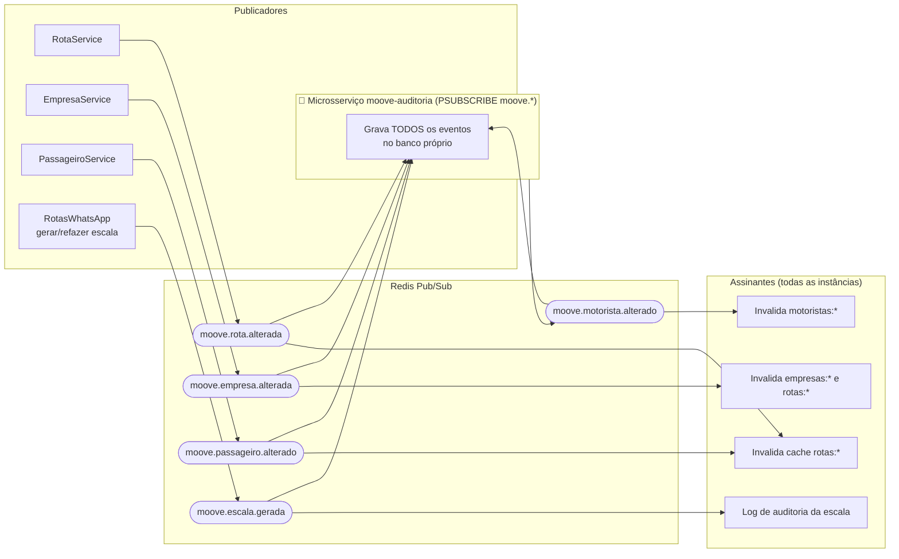

# Mensageria com Redis Pub/Sub

> Decisão: [ADR 0004](../adr/0004-redis-pubsub-eventos.md) · Código: `whatsappBot/src/infra/eventos/EventBus.ts` (publicação/assinatura) e `Assinantes.ts` (consumidores) · Testes: `src/__tests__/EventBus.test.ts`

## Arquitetura



## Contrato do evento (Published Language)

```json
{
  "id": "1d1b6c1e-7b5a-4d0f-9a43-3f1d8b8c2a10",
  "tipo": "moove.rota.alterada",
  "ocorridoEm": "2026-11-21T23:10:04.512Z",
  "origem": "moove-backend:42",
  "dados": { "rotaId": 3, "acao": "EDITADA" }
}
```

| Canal | `dados` | Ações possíveis em `acao` |
|---|---|---|
| `moove.rota.alterada` | `{ rotaId, acao }` | CRIADA, EDITADA, EXCLUIDA |
| `moove.empresa.alterada` | `{ empresaId, acao }` | CRIADA, EDITADA, EXCLUIDA |
| `moove.motorista.alterado` | `{ motoristaId, acao }` | CRIADO, EDITADO, ATIVADO, INATIVADO, EXCLUIDO, LID_VINCULADO |
| `moove.passageiro.alterado` | `{ passageiroId, acao }` | CRIADO, EDITADO, ATIVADO, INATIVADO, EXCLUIDO |
| `moove.escala.gerada` | `{ listaJoiaId, origem }` | — |

## Consumidores

| Consumidor | Onde roda | O que faz |
|---|---|---|
| `Assinantes.ts` | dentro do monólito (cada instância) | Sincroniza o cache e loga a auditoria da escala |
| **`moove-auditoria`** | **microsserviço separado** | Persiste todos os eventos `moove.*` (idempotente) e expõe `/auditoria/eventos` ([detalhes](microsservico-auditoria.md)) |

## Garantias e limitações
- **Conexão dedicada** para `SUBSCRIBE`. No protocolo Redis, uma conexão inscrita não executa outros comandos.
- **Publicar nunca quebra o negócio:** se o Redis estiver fora, o evento é descartado com log `Evento NÃO publicado` e métrica `resultado="descartado"`.
- **Isolamento:** um handler com erro não impede os outros.
- **Entrega "no máximo uma vez"** (*at-most-once*): por isso os efeitos críticos (invalidar o cache local) também são feitos de forma síncrona no próprio service. Para entrega garantida, a evolução prevista é **Redis Streams** (ADR 0004).

## Logs que comprovam a circulação

```json
{"nivel":"info","modulo":"EventBus","canal":"moove.rota.alterada","eventoId":"1d1b...","receptores":1,"dados":{"rotaId":3,"acao":"EDITADA"},"msg":"📤 Evento PUBLICADO"}
{"nivel":"info","modulo":"EventBus","canal":"moove.rota.alterada","eventoId":"1d1b...","origem":"moove-backend:42","msg":"📥 Evento RECEBIDO"}
{"nivel":"info","modulo":"Assinantes","eventoId":"1d1b...","dados":{"rotaId":3,"acao":"EDITADA"},"msg":"Rotas: cache sincronizado após evento"}
```

## Demonstração

```bash
# Terminal 1 – escuta TODOS os eventos do Moove direto no Redis
npm run docker:redis:eventos          # redis-cli PSUBSCRIBE "moove.*"

# Terminal 2 – logs da aplicação filtrando a mensageria
docker compose logs -f backend | grep -E "EventBus|Assinantes"

# Terminal 3 – gera eventos
curl -X PATCH -H "Authorization: Bearer $TOKEN" -H 'Content-Type: application/json' \
     -d '{"ativo": false}' http://localhost:8080/motoristas/5/status          # moove.motorista.alterado
curl -X POST -H 'Content-Type: application/json' -d '{"dia": 21}' \
     http://localhost:8080/whatsapp/escala/refazer                            # moove.escala.gerada

# Métricas da mensageria
curl -s http://localhost:8080/metrics | grep moove_eventos
```
