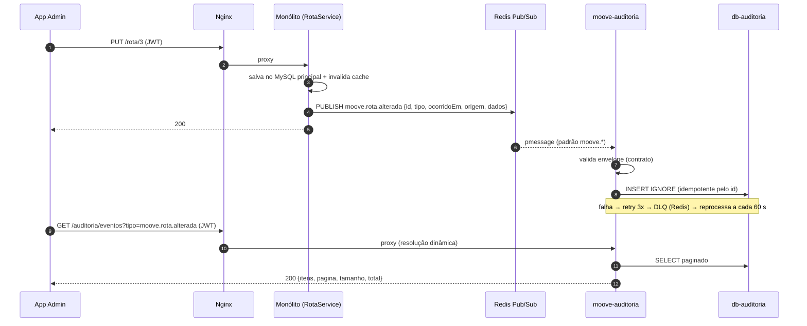

# Microsserviço `moove-auditoria`

> Decisão: [ADR 0008](../adr/0008-microsservico-de-auditoria.md) · Código: [`auditoria/`](../../auditoria/README.md) · Contrato: [`auditoria-openapi.yaml`](../03-api/auditoria-openapi.yaml)

## Por que ele é um microsserviço (e não só "mais um módulo")

| Critério | Monólito (`whatsappBot`) | Microsserviço (`auditoria`) |
|---|---|---|
| Código-fonte | `whatsappBot/` (submódulo) | `auditoria/` (projeto Node próprio, `package.json` próprio) |
| Processo / container | `backend` | `auditoria` |
| Banco de dados | `db` → `whatsapp_bot` | `db-auditoria` → `moove_auditoria` (**exclusivo**) |
| Pipeline | job `backend` | job `auditoria` |
| Imagem | `moove-backend:<sha>` | `moove-auditoria:<sha>` |
| Deploy / rollback | `deploy.sh <sha> backend` | `deploy.sh <sha> auditoria` |
| Escala horizontal | 1 instância (sessão WhatsApp) | N instâncias (idempotente) |
| Comunicação entre eles | — | **Somente eventos** (Redis Pub/Sub). Nenhuma chamada direta, nenhum banco compartilhado |

## Fluxo ponta a ponta



## Resiliência específica

| Situação | Comportamento |
|---|---|
| `db-auditoria` lento no boot | Retry com backoff (10 tentativas) antes de abrir a porta |
| `db-auditoria` cai em operação | Gravação tenta 3x; depois vai para a **DLQ** (`moove:auditoria:dlq`), reprocessada a cada 60 s ou via `POST /auditoria/dlq/reprocessar` |
| Evento repetido (reprocessamento, réplicas) | `INSERT IGNORE` pelo `id` → **idempotente** |
| Mensagem malformada | Descartada com log e métrica `resultado="invalido"`. Não vai para a DLQ porque repetir não resolveria |
| Redis cai | Reassinatura automática ao reconectar; `/health/ready` → `DEGRADED` |
| O serviço inteiro cai | O monólito não percebe. O Nginx retorna 502 **só** em `/auditoria/*` |

## Demonstração (roteiro)

```bash
npm run docker:rebuild                      # sobe tudo, incluindo db-auditoria e auditoria
npm run docker:health:auditoria               # {"status":"UP", "dependencias":{...}, "dlqPendentes":0}

# 1) Gere eventos no monólito (ex.: editar uma rota pelo app ou via curl)
curl -X PUT -H "Authorization: Bearer $TOKEN" -H 'Content-Type: application/json' \
     -d '{"horario":"18h10"}' http://localhost:8080/rota/1

# 2) Veja o consumo nos logs do microsserviço
docker compose logs auditoria | grep "Evento AUDITADO"

# 3) Consulte o histórico pela API do microsserviço
curl -s -H "Authorization: Bearer $TOKEN" "http://localhost:8080/auditoria/eventos?tipo=moove.rota.alterada" | jq
curl -s -H "Authorization: Bearer $TOKEN" "http://localhost:8080/auditoria/resumo?dias=7" | jq

# 4) Isolamento de falhas: derrube o microsserviço e veja o monólito seguir normal
docker compose stop auditoria
curl -s -o /dev/null -w "%{http_code}\n" http://localhost:8080/health/ready          # 200 (monólito)
curl -s -o /dev/null -w "%{http_code}\n" http://localhost:8080/auditoria/health       # 502 (só a auditoria)
docker compose start auditoria

# 5) DLQ: derrube o banco da auditoria, gere eventos e veja a fila crescer e depois esvaziar
docker compose stop db-auditoria
# ... gere eventos ...
docker compose exec redis redis-cli LLEN moove:auditoria:dlq
docker compose start db-auditoria      # em até 60 s a DLQ é reprocessada
```
