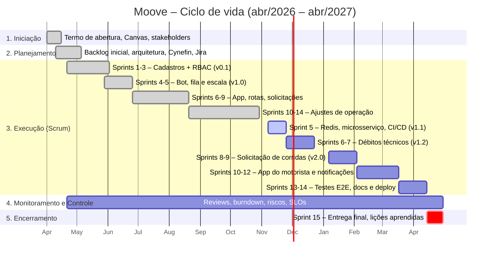

# Planejamento e condução do ciclo de vida do projeto

> Abordagem **híbrida** (justificada no [Cynefin](cynefin.md)): as **fases preditivas** organizam o projeto no nível macro, e a **Execução** acontece em **sprints Scrum** com releases incrementais.

## 1. Fases do ciclo de vida (visão preditiva)

| Fase | Objetivo | Entregáveis | Critério de saída |
|---|---|---|---|
| **1. Iniciação** | Definir o problema, o objetivo e os stakeholders | [PM Canvas](pm-canvas.md), objetivo SMART, lista de stakeholders | Canvas aprovado pelo PO |
| **2. Planejamento** | Escopo inicial, abordagem, arquitetura e ferramentas | [Cynefin](cynefin.md), [Product Backlog](product-backlog.md), [C4](../01-arquitetura/c4-nivel1-contexto.md), ADRs 0001/0002/0007, projeto no [Jira](jira.md), Definition of Done | Backlog com ≥ 2 sprints refinadas |
| **3. Execução** | Construir incrementos | Sprints de 2 semanas → releases v0.1, v1.0, v1.1 | Itens atendem à DoD |
| **4. Monitoramento e Controle** | Acompanhar prazo, escopo, qualidade e riscos | Burndown/velocity no Jira, revisão do Canvas (riscos), SLOs e error budget | Desvios tratados na Retrospectiva/Review |
| **5. Encerramento** | Formalizar a entrega | Release final, documentação, runbook, lições aprendidas, repasse | Aceite da banca/PO |

## 2. Papéis de gestão

| Papel | Quem | Responsabilidades na gestão |
|---|---|---|
| **Gerente de Projeto / Scrum Master** | _(preencher)_ | Dono do cronograma macro, dos marcos e do registro de riscos; facilita as cerimônias; mantém o Jira saudável (WIP, impedimentos) |
| **Product Owner** | _(preencher)_ | Dono do backlog: escreve e prioriza as user stories, aceita incrementos, define releases |
| **Analista / Arquiteto** | _(preencher)_ | Mantém C4, ADRs e Quality Scenarios; refina critérios de aceite técnicos |
| **Time de desenvolvimento** | _(preencher)_ | Estima (story points), implementa, testa e documenta |
| **QA / DevOps** | _(preencher)_ | Pipeline, testes E2E, observabilidade, deploy |

**Matriz RACI (resumo)**

| Atividade | GP/SM | PO | Arquiteto | Devs |
|---|---|---|---|---|
| Priorizar backlog | C | **A/R** | C | I |
| Planejar sprint | **A** | R | C | R |
| Decisões de arquitetura (ADR) | I | C | **A/R** | C |
| Deploy em produção | A | I | C | **R** |
| Gestão de riscos | **A/R** | C | C | I |

## 3. Execução com Scrum

| Elemento | Definição no Moove |
|---|---|
| Sprint | 2 semanas. Calendário das 15 sprints em [jira.md](jira.md#sprints-e-releases) |
| Planning | 1 h: meta da sprint + seleção do backlog por capacidade (velocity média) |
| Daily | 15 min (assíncrona pelo WhatsApp da equipe quando necessário) |
| Review | Demonstração para o PO e a operação; incremento implantado |
| Retrospectiva | Formato "Começar / Parar / Continuar"; ações viram itens no Jira |
| Refinamento | Semanal, 30 min; stories com critérios de aceite + estimativa |
| Estimativa | Story points (Fibonacci 1, 2, 3, 5, 8, 13) |
| Sustentação | Bugs e incidentes em **Kanban** (coluna expressa, WIP 2) |

### Definition of Ready (DoR)
- [ ] Story no formato *Como… quero… para…*
- [ ] Critérios de aceite em Dado/Quando/Então
- [ ] Estimada e sem dependências bloqueantes

### Definition of Done (DoD)
- [ ] Código revisado em PR e pipeline CI verde (typecheck + testes + build)
- [ ] Critérios de aceite validados pelo PO
- [ ] Logs/métricas relevantes adicionados
- [ ] Documentação atualizada (OpenAPI, ADR se houve decisão, CHANGELOG)
- [ ] Item fechado no Jira com link do PR

## 4. Versionamento e releases

- **SemVer** (`MAJOR.MINOR.PATCH`) registrado no [CHANGELOG](../../CHANGELOG.md) e como **Fix Version** no Jira.
- **Conventional Commits** (validados pelo Husky) permitem gerar o changelog a partir do histórico.
- **Releases parciais:** cada release agrupa épicos concluídos e pode ser implantada isoladamente.

| Release | Conteúdo | Status |
|---|---|---|
| v0.1.0 | Cadastros, endereçamento, autenticação | Entregue |
| v0.5.0 | Bot WhatsApp: fila de joinhas, comandos | Entregue |
| v1.0.0 | Escala automática (plantão/rota/apoio), rotas tarde/madrugada, app mobile | Entregue |
| v1.0.x | RBAC, solicitações de corrida, ajustes manuais na escala, E2E + Husky | Entregue |
| **v1.1.0** | Redis (cache + Pub/Sub), **microsserviço de auditoria**, observabilidade, resiliência, CI/CD, Nginx corrigido, documentação arquitetural | **Esta entrega** |
| v1.2.0 | Débitos técnicos (SCRUM-42 a SCRUM-50), stack Grafana/Loki | Planejada (22/12/2026) |
| **v2.0.0** | **Fase final:** solicitação de corridas pelos passageiros via WhatsApp (épico SCRUM-10) e app do motorista com notificações e respostas repassadas pelo bot (épico SCRUM-11) | Planejada (**30/04/2027**) |
