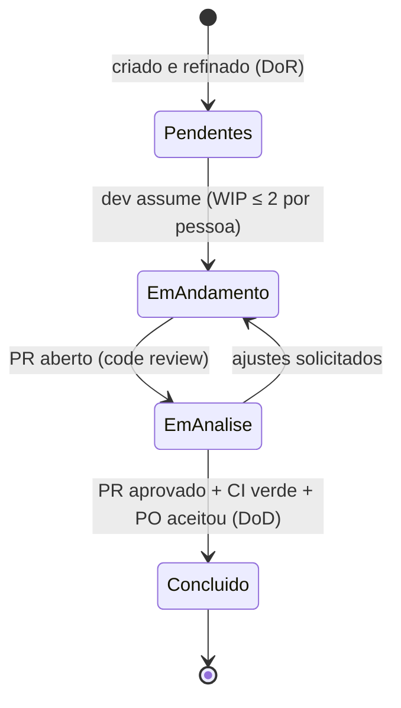

# Gestão do trabalho e do progresso via Jira

> **Site:** https://jchabapst.atlassian.net · **Projeto:** "Meu espaço Scrum" (chave **`SCRUM`**, Scrum *team-managed*) · **Board:** [SCRUM board](https://jchabapst.atlassian.net/jira/software/projects/SCRUM/boards/2)
> As chaves citadas em toda a documentação (SCRUM-12, SCRUM-52…) são **as chaves reais dos itens no Jira**.

## 1. O que está cadastrado

| Elemento | Quantidade | Detalhe |
|---|---|---|
| **Épicos** | 10 | SCRUM-2 a SCRUM-11 (E1–E10, um por pacote de entrega do PM Canvas) |
| **Itens** | 60 | 52 histórias, 7 tarefas e 1 bug (SCRUM-1, SCRUM-12 a SCRUM-70), todos vinculados a um épico, com descrição no formato *Como… quero… para…*, critérios de aceite, prioridade, *story points*, labels e responsável |
| **Sprints** | 15 | 4 encerradas, **1 ativa** (Sprint 5, até 24/11/2026) e 10 futuras (até 27/04/2027) |
| **Releases** | 7 | v0.1.0 → v1.1.0 publicadas · v1.2.0 (22/12/2026) e **v2.0.0 (30/04/2027)** planejadas |

### Épicos
| Chave | Épico | Status |
|---|---|---|
| SCRUM-2 | E1 – Cadastros de parceiros | Concluído |
| SCRUM-3 | E2 – Fila de joinhas e escala | Em andamento |
| SCRUM-4 | E3 – Rotas e atribuições | Em andamento |
| SCRUM-5 | E4 – Bot WhatsApp | Concluído |
| SCRUM-6 | E5 – App mobile de gestão | Concluído |
| SCRUM-7 | E6 – Segurança e acesso | Em andamento |
| SCRUM-8 | E7 – Infra, performance e observabilidade | Em andamento |
| SCRUM-9 | E8 – Documentação e gestão | Em andamento |
| SCRUM-10 | **E9 – Solicitação de corridas pelos passageiros (WhatsApp)** | A fazer (fase final) |
| SCRUM-11 | **E10 – App do motorista e notificações** | A fazer (fase final) |

### Sprints e releases
| Sprint | Período | Objetivo | Release | Estado |
|---|---|---|---|---|
| 1 | 21/04 – 04/05/2026 | Cadastros e login | v0.1.0 | Encerrada |
| 2 | 05/05 – 18/05/2026 | Bot e fila de joinhas | v0.5.0 | Encerrada |
| 3 | 19/05 – 01/06/2026 | Escala e rotas | v1.0.0 | Encerrada |
| 4 | 02/06 – 30/06/2026 | Segurança e ajustes da operação | v1.0.1 | Encerrada |
| **5** | **07/11 – 24/11/2026** | **Arquitetura, Redis, microsserviço, CI/CD e Jira (rubrica)** | **v1.1.0** | **Ativa** |
| 6 | 25/11 – 08/12/2026 | Débitos de segurança e dados | v1.2.0 | Futura |
| 7 | 09/12 – 22/12/2026 | Refatoração e observabilidade | v1.2.0 | Futura |
| 8 | 06/01 – 19/01/2027 | Solicitação de corridas I | v2.0.0 | Futura |
| 9 | 20/01 – 02/02/2027 | Solicitação de corridas II | v2.0.0 | Futura |
| 10 | 03/02 – 16/02/2027 | App do motorista: base e login | v2.0.0 | Futura |
| 11 | 17/02 – 02/03/2027 | Notificações push | v2.0.0 | Futura |
| 12 | 03/03 – 16/03/2027 | Respostas do motorista via bot | v2.0.0 | Futura |
| 13 | 17/03 – 30/03/2027 | Testes E2E e estabilização | v2.0.0 | Futura |
| 14 | 31/03 – 13/04/2027 | Documentação e deploy da v2.0 | v2.0.0 | Futura |
| 15 | 14/04 – 27/04/2027 | Entrega final | v2.0.0 | Futura |

## 2. Workflow



| Coluna | Status no Jira | Regra |
|---|---|---|
| A fazer | Tarefas pendentes | Só entram itens que atendem à **DoR** |
| Em andamento | Em andamento | WIP máximo de 2 por pessoa |
| Revisão | Em análise | PR vinculado obrigatório |
| Concluído | Concluído | Atende à **DoD** ([ciclo-de-vida.md](ciclo-de-vida.md#definition-of-done-dod)) |

## 3. Pendências de configuração (feitas na interface do Jira)

1. **Ativar o recurso de Releases no projeto**, para associar os itens às versões já criadas: *Configurações do projeto → Recursos → Releases → ativar*. Depois de ativado, os itens podem receber a **Fix version** (a release de cada item está na descrição: "Release: vX").
2. **(Opcional) Renomear o projeto** para "Moove": *Configurações do projeto → Detalhes → Nome*. A chave continua `SCRUM`.
3. **Conectar o GitHub** (seção 4).

## 4. Rastreabilidade código ↔ Jira (GitHub for Jira)

1. Jira → **Apps → Explore more apps** → **GitHub for Jira** → **Get app**.
2. **Get started → GitHub Cloud** → entrar com a conta `123JChaves` → **Connect**.
3. Liberar os repositórios `app-moove`, `whatsappBot` e `jcha_app`.

Depois disso, toda branch, commit ou PR com a chave aparece no painel **Development** do item:

| Onde | Exemplo |
|---|---|
| Branch | `feature/SCRUM-53-solicitar-corrida` |
| Commit | `feat(solicitacoes): registra solicitacao pelo whatsapp SCRUM-53` |
| Pull Request | `SCRUM-53 Solicitar corrida pelo WhatsApp` |
| Smart commit | `fix: corrige rota duplicada SCRUM-43 #comment upsert unico #done` |

O formato de commit é compatível com a validação do Husky (`tipo: mensagem`).

## 5. Acompanhamento do progresso

| Instrumento | Uso | Frequência |
|---|---|---|
| **Board da sprint** | Fluxo diário; impedimentos sinalizados com *flag* | Daily |
| **Burndown** | Previsibilidade da meta da sprint | Daily / Review |
| **Velocity** | Capacidade média para o Planning (Sprints 1–5 como histórico) | Planning |
| **Cumulative Flow** | Gargalos (ex.: acúmulo em "Em análise") | Retrospectiva |
| **Releases** | % concluído por versão (v1.2.0, v2.0.0) | Semanal |
| **Timeline** | Visão dos épicos E1–E10 até abril/2027 | Stakeholders |

### Filtros JQL úteis
```sql
-- Sprint atual
project = SCRUM AND sprint in openSprints()

-- Fase final (entrega abril/2027)
project = SCRUM AND parent in (SCRUM-10, SCRUM-11) ORDER BY rank

-- Débitos técnicos priorizados
project = SCRUM AND labels = debito ORDER BY priority DESC

-- Itens ainda abertos
project = SCRUM AND statusCategory != Done AND issuetype != Epic ORDER BY priority DESC
```

## 6. Evidências para a avaliação (prints)
- [ ] **Board** da Sprint 5 (ativa)
- [ ] **Backlog** com as sprints futuras e os épicos
- [ ] **Relatório de velocity** ou **burndown**
- [ ] **Timeline** com os épicos até abril/2027
- [ ] Um item com o painel **Development** mostrando commit/PR (após conectar o GitHub)
- [ ] Página **Releases** com as versões

O arquivo [`jira-importacao.csv`](jira-importacao.csv) continua no projeto como cópia de segurança do backlog (a coluna *Issue ID* já usa as chaves reais).
