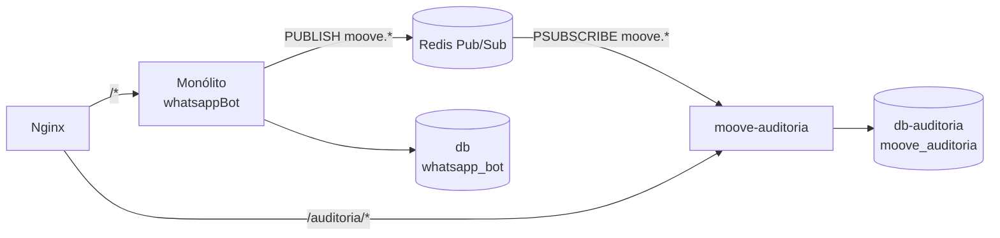

# ADR-0008: Extrair o contexto de Auditoria como microsserviço

- **Status:** Aceita. **Complementa** a [ADR-0001](0001-monolito-modular.md): o núcleo continua como monólito modular, e a Auditoria passa a ser um serviço satélite
- **Data:** 2026-11-21
- **Decisores:** Equipe Moove

## Contexto e problema

1. O projeto precisa demonstrar pelo menos **um microsserviço** real: deploy independente, dados próprios, comunicação por API/eventos.
2. O histórico do que aconteceu na operação (quem gerou a escala, quando uma rota ou um motorista mudou) existia **só em log**, que se perde. A operação precisa consultar esse histórico em caso de reclamação de motoristas e empresas.
3. Os eventos de domínio já são publicados no Redis Pub/Sub ([ADR-0004](0004-redis-pubsub-eventos.md)).

## Opções consideradas

| Opção | Acoplamento com o monólito | Risco | Valor |
|---|---|---|---|
| Extrair o **bot do WhatsApp** | Alto (EscalaService, sessão única) | Alto | Alto |
| Extrair **Endereçamento** (+ CEP) | Médio (cadastro de passageiros chama o serviço) | Médio | Baixo |
| Serviço de **Notificações** | Precisaria da sessão do WhatsApp | Alto | Médio |
| **Serviço de Auditoria** consumindo eventos | **Nenhum no código do monólito** (só assina eventos já publicados) | **Baixo** | Médio-alto |

## Decisão

Criar o microsserviço **`moove-auditoria`** (pasta `auditoria/`):

- **Bounded context próprio (BC7 – Auditoria):** registrar e consultar fatos de domínio.
- **Database-per-service:** container `db-auditoria` (MySQL 8, `moove_auditoria`). Nenhum outro serviço acessa esse banco.
- **Entrada assíncrona:** `PSUBSCRIBE moove.*` no Redis. O monólito **não sabe** que o serviço existe (baixo acoplamento).
- **Saída síncrona:** API REST `/auditoria/*` roteada pelo Nginx.
- **Autenticação stateless:** valida o JWT do monólito com o `JWT_SECRET` compartilhado, sem consultar o banco do monólito.
- **Pipeline, imagem e deploy próprios:** `./scripts/deploy.sh <sha> auditoria`.
- **Mesma stack** (Node 20 + TypeScript + Express) para reduzir a carga cognitiva da equipe pequena.

## Consequências

- ✅ O microsserviço tem deploy, banco, pipeline e escalabilidade independentes. Ele pode rodar **N réplicas** (gravação idempotente pelo `id` do evento), ao contrário do bot.
- ✅ Isolamento de falhas: auditoria fora não afeta escala, rotas nem WhatsApp. O Nginx resolve o upstream dinamicamente, então só `/auditoria` retorna 502.
- ✅ Histórico consultável, com política de retenção de 180 dias (LGPD).
- ⚠️ **Pub/Sub é at-most-once:** se o serviço estiver fora no momento da publicação, os eventos daquele intervalo **não são auditados**. Mitigações atuais: `restart: unless-stopped`, healthcheck e DLQ para falhas do banco. **Evolução:** migrar o canal para **Redis Streams** com *consumer group* (entrega garantida e replay). Item SCRUM-51 do backlog.
- ⚠️ Mais containers para operar (+1 MySQL, ~150–250 MB de RAM).
- ⚠️ Segredo JWT compartilhado: a rotação do `JWT_SECRET` exige atualizar os dois serviços. Evolução possível: JWT assinado com chave assimétrica (RS256), com o serviço guardando só a chave pública.
- 🔁 **Próximo candidato à extração:** o Contexto de Comunicação (bot), quando o `EscalaService` estiver desacoplado (SCRUM-49).
